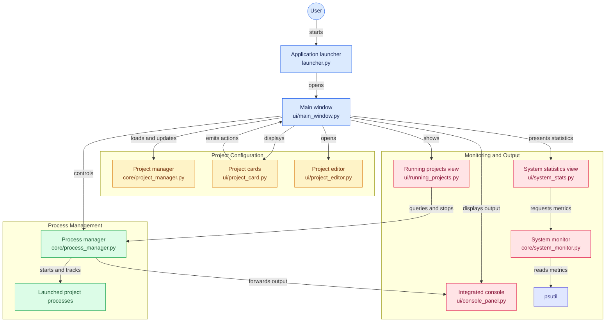

# 🚀 Project Hub

### Your development projects. One workspace.

**Project Hub** is a centralized Windows desktop application built with Python and PySide6 for launching, managing, and monitoring development projects from a single graphical interface.

Stop switching between project folders and manually managing processes. Project Hub brings project management, process control, console output, and system resource monitoring together in one place.

<p align="center">
  <a href="https://github.com/Allen-Paul-18/ProjectHub">
    
  </a>
  
  
  
</p>

> **Status:** Active development

---

## 📑 Table of Contents

- [Features](#-features)
- [Architecture](#-architecture)
- [Tech Stack](#-tech-stack)
- [Project Structure](#-project-structure)
- [Prerequisites](#-prerequisites)
- [Installation](#-installation)
- [Configuration](#-configuration)
- [Usage](#-usage)
- [Development](#-development)
- [Roadmap](#️-roadmap)
- [Security](#-security)
- [Contributing](#-contributing)
- [License](#-license)

---

## ✨ Features

### 📁 Project Management

- Manage multiple development projects from one interface.
- Display projects using organized project cards.
- Search and filter projects.
- Add, edit, and delete project configurations.
- Configure project directories, commands, and virtual environments.
- Store project configurations in JSON.

### ⚙️ Process Management

- Launch projects directly from the dashboard.
- Stop and restart managed processes.
- Track the execution state of launched projects.
- Capture standard output and error output.
- Display application logs in an integrated console.
- View running projects in a dedicated interface.

### 📊 System Monitoring

- Monitor CPU utilization.
- Track RAM usage and total memory.
- Display system resource statistics in the sidebar.
- Refresh metrics periodically using Qt timers.
- Collect system statistics using `psutil`.

### 🖥️ Integrated Console

- View output from launched applications.
- Monitor process activity without switching windows.
- Inspect errors and diagnostic messages.
- Clear console output when needed.

### 🧭 Centralized Workspace

- Navigate between Overview and Running Projects.
- Keep project management and process monitoring in one application.
- Organize functionality into separate UI and core modules.

---

## 🏗️ Architecture

Project Hub uses a modular architecture that separates the graphical interface, project configuration, process lifecycle management, and system monitoring.

The main window coordinates these components while individual modules handle their respective responsibilities.



### Component Responsibilities

| Component | Responsibility |
|---|---|
| `launcher.py` | Initializes and launches the desktop application. |
| `ui/main_window.py` | Coordinates the main interface, navigation, and application components. |
| `core/project_manager.py` | Loads, updates, and saves project configurations. |
| `core/process_manager.py` | Manages project processes and forwards their output. |
| `ui/project_card.py` | Displays individual projects and their available actions. |
| `ui/project_editor.py` | Provides the project configuration editor. |
| `ui/console_panel.py` | Displays application output and diagnostic messages. |
| `ui/running_projects.py` | Displays currently running managed projects. |
| `core/system_monitor.py` | Collects CPU and memory statistics. |
| `ui/system_stats.py` | Provides a system statistics interface. |

*Note: The diagram describes the intended component relationships. The exact runtime behavior depends on the current implementation.*

---

## 🛠️ Tech Stack

| Technology | Purpose |
|---|---|
| Python | Application logic |
| PySide6 | Desktop graphical interface |
| Qt `QProcess` | Process execution and lifecycle management |
| Qt `QTimer` | Periodic UI updates and monitoring |
| `psutil` | CPU, RAM, and system statistics |
| JSON | Project configuration and persistence |
| Git and GitHub | Version control and source hosting |

---

## 📂 Project Structure

```text
ProjectHub/
├── launcher.py
├── README.md
├── .gitignore
├── requirements.txt
│
├── core/
│   ├── process_manager.py
│   ├── project_manager.py
│   ├── system_monitor.py
│   └── port_monitor.py
│
└── ui/
    ├── main_window.py
    ├── dashboard.py
    ├── project_card.py
    ├── project_editor.py
    ├── console_panel.py
    ├── running_projects.py
    ├── system_stats.py
    └── terminal_panel.py
```

**Core modules**

- `process_manager.py` — launches, stops, and tracks project processes.
- `project_manager.py` — manages project configuration data.
- `system_monitor.py` — retrieves system resource statistics.
- `port_monitor.py` — contains port-monitoring functionality.

**UI modules**

- `main_window.py` — main application window and navigation.
- `dashboard.py` — dashboard-related interface components.
- `project_card.py` — project card interface.
- `project_editor.py` — project configuration editor.
- `console_panel.py` — integrated console.
- `running_projects.py` — running process view.
- `system_stats.py` — system statistics interface.
- `terminal_panel.py` — terminal-related interface components.

---

## 📋 Prerequisites

Before installing Project Hub, ensure you have:

- Windows 10 or Windows 11.
- Python 3.11 or a compatible Python version.
- Git.
- An internet connection for downloading dependencies.

Individual projects launched through Project Hub may require their own dependencies and runtimes.

---

## 🚀 Installation

### 1. Clone the repository

```powershell
git clone https://github.com/Allen-Paul-18/ProjectHub.git
cd ProjectHub
```

### 2. Create a virtual environment

```powershell
python -m venv .venv
```

### 3. Activate the environment

```powershell
.\.venv\Scripts\Activate.ps1
```

If PowerShell blocks script execution, you can activate the environment using Command Prompt:

```cmd
.venv\Scripts\activate.bat
```

### 4. Install dependencies

If `requirements.txt` is present:

```powershell
python -m pip install -r requirements.txt
```

Otherwise, install the core dependencies:

```powershell
python -m pip install PySide6 psutil
```

### 5. Launch the application

```powershell
python launcher.py
```

Project Hub should open in its desktop window.

---

## 📝 Configuration

Project Hub uses a JSON configuration file to define the projects available in the dashboard.

### Example project configuration

The following example illustrates the expected configuration concept. Adjust the fields to match the schema used by the current version of Project Hub.

```json
[
  {
    "name": "Example Python Project",
    "description": "A sample Python application",
    "category": "Python",
    "icon": "🐍",
    "path": "E:/Projects/ExampleProject",
    "type": "python",
    "command": "main.py",
    "venv": "E:/Projects/ExampleProject/.venv"
  }
]
```

### Configuration fields

| Field | Description |
|---|---|
| `name` | Project name displayed in the dashboard. |
| `description` | Short description of the project. |
| `category` | Project category. |
| `icon` | Icon or emoji shown on the project card. |
| `path` | Project's root directory. |
| `type` | Project type used by the launch configuration. |
| `command` | Command or entry point used to launch the project. |
| `venv` | Optional path to a project-specific virtual environment. |

**Important:** Field names, accepted values, and command formats must match the implementation in `core/project_manager.py` and `core/process_manager.py`.

### Supporting different project types

A project may need a different launch command depending on its framework.

For example, a Streamlit application can be launched with:

```powershell
python -m streamlit run app.py
```

A Python script might instead use:

```powershell
python main.py
```

Ensure that the required packages are installed in the interpreter or virtual environment used to launch the project.

### Local configuration

Project paths and virtual environment locations are machine-specific. Configure them for your own environment rather than relying on another developer's local paths.

---

## 💻 Usage

1. Start Project Hub using `python launcher.py`.
2. Browse available projects in Overview.
3. Search for the project you want to work with.
4. Launch a project using its available controls.
5. Inspect output in the integrated console.
6. Open Running Projects to view managed processes.
7. Stop or restart projects using the available process controls.
8. Monitor CPU and memory usage from the sidebar.

The exact available actions depend on the current application version and project configuration.

---

## 🧑‍💻 Development

Project Hub is organized into independent modules to make future changes easier to maintain.

### Development workflow

1. Fork the repository.
2. Clone your fork.
3. Create a feature branch.
4. Implement and test your changes.
5. Commit your changes.
6. Open a pull request.

Create a feature branch:

```powershell
git checkout -b feature/my-feature
```

Run the application during development:

```powershell
python launcher.py
```

### Suggested development practices

- Keep UI components separate from core process logic.
- Avoid hardcoding machine-specific project paths.
- Validate project configuration before launching processes.
- Handle process errors and missing executables gracefully.
- Keep dependencies documented.
- Test project launching, stopping, restarting, and console output after changes.

---

## 🗺️ Roadmap

Planned improvements for Project Hub include:

- [ ] Quick terminal access for individual projects.
- [ ] Active port monitoring with process names and PIDs.
- [ ] Stop All Projects action.
- [ ] Functional Settings page.
- [ ] Active sidebar navigation highlighting.
- [ ] Improved process status reporting.
- [ ] More detailed resource monitoring.
- [ ] UI refinements and usability improvements.
- [ ] Screenshots and demonstrations in the README.

This roadmap may change as development progresses.

---

## 🔒 Security

Project Hub can execute commands and applications on the local machine. Review project configurations before launching unfamiliar commands.

- Never commit API keys, passwords, access tokens, or private credentials.
- Keep local environment files out of version control.
- Avoid publishing sensitive local project paths in configuration files.
- Do not launch untrusted projects without reviewing their commands.
- Remember that launched applications may inherit the permissions of the current user.

---

## 🤝 Contributing

Contributions, bug reports, and feature suggestions are welcome.

If you would like to contribute:

1. Fork the repository.
2. Create a feature branch.
3. Make your changes.
4. Test the affected functionality.
5. Submit a pull request describing your changes.

For bug reports, include the steps to reproduce the problem and any relevant error messages.

---

## 📄 License

No license has been specified yet.

If you intend to make Project Hub open source, add a `LICENSE` file that clearly defines the permissions and conditions for using, modifying, and distributing the project.

---

## 🌟 Acknowledgements

- [Python](https://www.python.org/)
- [Qt for Python — PySide6](https://doc.qt.io/qtforpython-6/)
- [psutil](https://github.com/giampaolo/psutil)
- [GitHub](https://github.com/)

---

<p align="center">
  <b>Project Hub</b><br>
  One workspace. Multiple projects. A smoother development workflow.
</p>
